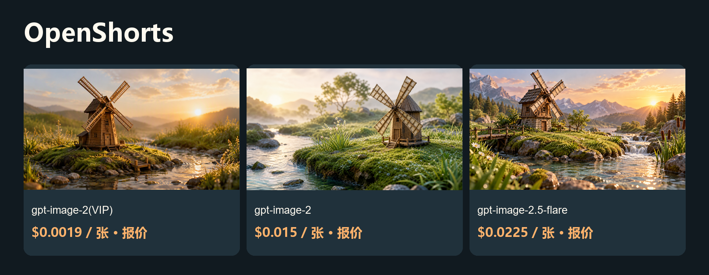

# 更低成本的 OpenShorts 图片与视频方案


<!-- TOAPIS-MODELS-20261020 -->
## 模型与价格更新 · 2026-10-20

新增可独立运行的31套图片请求模板、8套视频模板。当前26套图片与8套视频可匹配同Key精确价格；另5套图片缺价，默认阻止新付费调用。它们属于额外API脚本；项目原生Provider、UI、导入及完整出片的验收范围仍以下方原教程为准。

| 图片模型／实测档位 | 当前档位报价／张 | 历史案例金额／张 | 费用证据 |
|---|---:|---:|---|
| gpt-image-2(VIP)<br><sub>low</sub> | $0.0019/image | **$0.0019/image** | 计费日志，阶段未知 |
| gpt-image-2.5-flare-vip<br><sub>low</sub> | 当前Key暂未返回报价 | **$0.005272/image**<br><sub>Token计费；当前$/M未返回，本例金额不是固定单张价。</sub> | 任务回执已结算 |
| nano_banana<br><sub>1K</sub> | $0.012/image | **$0.012/image** | 计费日志，阶段未知 |
| gemini-nano-banana-2.1<br><sub>1K</sub> | $0.015/image | **$0.015/image** | 计费日志，阶段未知 |
| gpt-image-2<br><sub>1K</sub> | $0.015/image | **$0.015/image** | 计费日志，阶段未知 |
| gemini-nano-banana-2.1-vip<br><sub>1K</sub> | $0.02/image | **$0.02/image** | 计费日志，阶段未知 |
| qwen-image-3.0<br><sub>1K</sub> | 当前Key暂未返回报价 | **$0.021/image** | 计费日志，阶段未知 |
| gpt-image-2.5-flare<br><sub>high</sub> | $0.0225/image | **$0.0225/image** | 计费日志，阶段未知 |
| gpt-image-2.5-sunburst<br><sub>high</sub> | $0.0225/image | **$0.0225/image** | 计费日志，阶段未知 |
| flux-2-pro<br><sub>1K</sub> | $0.025/image | **$0.025/image** | 计费日志，阶段未知 |
| doubao-seedream-5-0-pro<br><sub>1K</sub> | $0.042857/image | **$0.042856/image** | 计费日志，阶段未知 |

| 视频模型 | 档位／输入 | 本例消费 | 文件时长 | 本例每秒金额（升序） |
|---|---|---:|---:|---|
| MiniMax-H3-Max-Turbo | 5s / 480P / 文生视频 | $0.125/clip | 5.18s | **$0.024131/s**<br><sub>pricing底层费率：$0.025/s</sub> |
| seedance-2-mini | 4s / 480p / 首帧 | $0.13338/clip | 4.04s | **$0.033015/s**<br><sub>pricing底层费率：$3.285714/M total tokens</sub> |
| seedance-2-fast | 4s / 480p / 文生视频 | $0.214568/clip | 4.04s | **$0.053111/s**<br><sub>pricing底层费率：$5.285714/M total tokens</sub> |
| kling-v3 | 5s / 720p / std / 文生视频 | $0.3/clip | 5.04s | **$0.059524/s**<br><sub>pricing底层费率：$0.06/s</sub> |
| MiniMax-H3 | 5s / 768p / 文生视频 | $0.32/clip | 5.17s | **$0.061896/s**<br><sub>pricing底层费率：$0.064/s</sub> |
| seedance-2 | 4s / 480p / 首帧 | $0.26676/clip | 4.04s | **$0.06603/s**<br><sub>pricing底层费率：$6.571429/M total tokens</sub> |
| kling-3.0-turbo | 4s / 720p / 文生视频 | $0.32/clip | 4.04s | **$0.079208/s**<br><sub>pricing底层费率：$0.08/s</sub> |
| seedance-2-5 | 4s / 480p / 文生视频 | $0.3883/clip | 4.04s | **$0.096114/s**<br><sub>pricing底层费率：$10/M total tokens</sub> |

报价核对：2026-10-20。图片案例日期2026-10-17；视频案例日期2026-10-20。表格按本例金额／秒金额排序，质量、分辨率和输入不同，不是同配置质量排名。图片日志的阶段未知，不能当作单任务最终净结算；当前报价与历史金额分别显示。视频金额均由billing=settled确认，$/s按实际文件时长折算，任务处理耗时不参与计算。Token模型不是固定每秒价，底层$/M只作小字补充。

gpt-image-2(VIP)通用价格为$0.0019/image起；本例low/1K为$0.0019/image。新脚本有31套历史成功图片请求模板、8套视频模板；当前26套图片与8套视频可匹配价格，另5套图片因当前Key缺价而默认阻止新付费调用。

[本仓库多模型脚本](../toapis-models/README_zh-CN.md) · [完整价表](../PRICING_zh-CN.md) · [原图／视频及费用证据](https://github.com/ToAPIs-2025/toapis-quickstart/tree/main/tutorials/model-support-2026-10-20)

下方保留原项目历史案例、消费及集成说明；历史金额不改成今天的新报价。

<!-- /TOAPIS-MODELS-20261020 -->

从话题到短视频的本地工作流，素材可以复用。

[English](README.md) · [Model & pricing](https://go2v.toapis.com/1020_os_g) · [Upstream](https://github.com/jnMetaCode/openshorts)

**ToAPIs独立社区方案，非上游官方版本。** 本轮验证API、配置契约或局部Adapter，完整产品流程尚未验收。

## 演示



[](examples/seedance-2.mp4)

[▶ 查看真实视频](examples/seedance-2.mp4)

视频参数：seedance-2 · 480p · 4s requested / 4.04s decoded · 16:9 · generate_audio=false · first-frame I2V.

视频实际消费：$0.26676 / clip · $0.06602970297029702970297029703/s (this case).

## 本例花费与模型价格（升序）

2026-10-20.

| 模型／档位 | 类型 | 本例金额／报价 | 对应模型价格 | 费用依据 |
|---|---|---:|---|---|
| gpt-image-2(VIP)<br>low / 1K | 图片 | 报价 $0.0019 | $0.0019/image | 档位报价；单任务未返回结算 |
| gpt-image-2<br>1K | 图片 | 报价 $0.015 | $0.015/image | 档位报价；单任务未返回结算 |
| gpt-image-2.5-flare<br>high / 1K | 图片 | 报价 $0.0225 | $0.0225/image | 档位报价；单任务未返回结算 |
| seedance-2<br>480p / 4.04s / 无声 | 视频 | $0.26676 | $6.571429/1M total tokens | API billing=settled |

gpt-image-2(VIP)通用价格为$0.0019/image起；本例low/1K为$0.0019/image。图片按当期同Key档位报价标识，未把缺失回执写成实扣。三模型使用本项目相同提示词，但质量档位不同，不能视为同等质量比较。视频美元/秒是本例折算，不是固定秒价。

## 对应项目的复用方法

1. 这是保留上游源码、历史和许可的正式Fork；独立教程及原创可选Adapter位于toapis-guide/。
2. integration/toapis-image-adapter.mjs遵循固定src/adapters/types.ts的ImageGenerationAdapter/GeneratedAsset形状，尚未自动注册到OpenShorts或agency-orchestrator（AO）。
3. 启动鉴权回环桥后，以稳定runId、独立桥接Token和绝对输出目录调用createToAPIsImageAdapter；未支持的种子、透明背景或负面词会在提交前拒绝。
4. 该模块已通过真实回环HTTP回放3张真实PNG，读取实际尺寸并检查不支持选项；回放不产生新增费用。
5. Seedance片段可作为原创素材复用。AO注册、配音、字幕及整片渲染仍待验证；工具自己的音频能力不归为ToAPIs能力。

## 运行独立API案例

```powershell
$env:TOAPIS_API_KEY="your_private_key"
python run_case.py --job jobs/gpt-image-2-vip.json
python run_case.py --job jobs/gpt-image-2-vip.json --live
python run_case.py --job jobs/video.json
python run_case.py --job jobs/video.json --live
```

不加--live仅查当前Key价格。先在本地设置预算；脚本提供单任务限额，不代表托管账户全局消费限制。失败或超时先查保存的原任务，不重复提交。

## 可选同步桥接

```powershell
$env:BRIDGE_TOKEN="replace_with_a_separate_random_token_at_least_24_chars"
$env:BRIDGE_PORT="8769"
python bridge.py
```

只监听127.0.0.1；界面填独立桥接Token，不填写真实ToAPIs Key。不改变上游SSRF/出站策略，不用于公共托管服务。图片仅文生图；视频桥只支持明确的首帧、尺寸与4秒档位。

## 原创输入与输出

```text
An original cinematic educational-video still: a handcrafted miniature wooden windmill on a grassy island beside a clear stream, morning dew, small reeds and stones, soft sunrise, precise tactile textures, friendly nature-documentary aesthetic, clear single composition, 16:9 landscape, no text, no logos, no watermark.
```

[Jobs](jobs/) · [Original media](examples/) · [Sanitized evidence](evidence/) · [Acceptance](ACCEPTANCE.md) · [Upstream and protocol evidence](UPSTREAM.md)

## 许可与边界

Original guide/adapter code: MIT. Upstream source and trademarks keep their own license and ownership. The OpenShorts fork retains its upstream MIT license. No existing sponsor/referral links were replaced. No audio integration claim is made.
